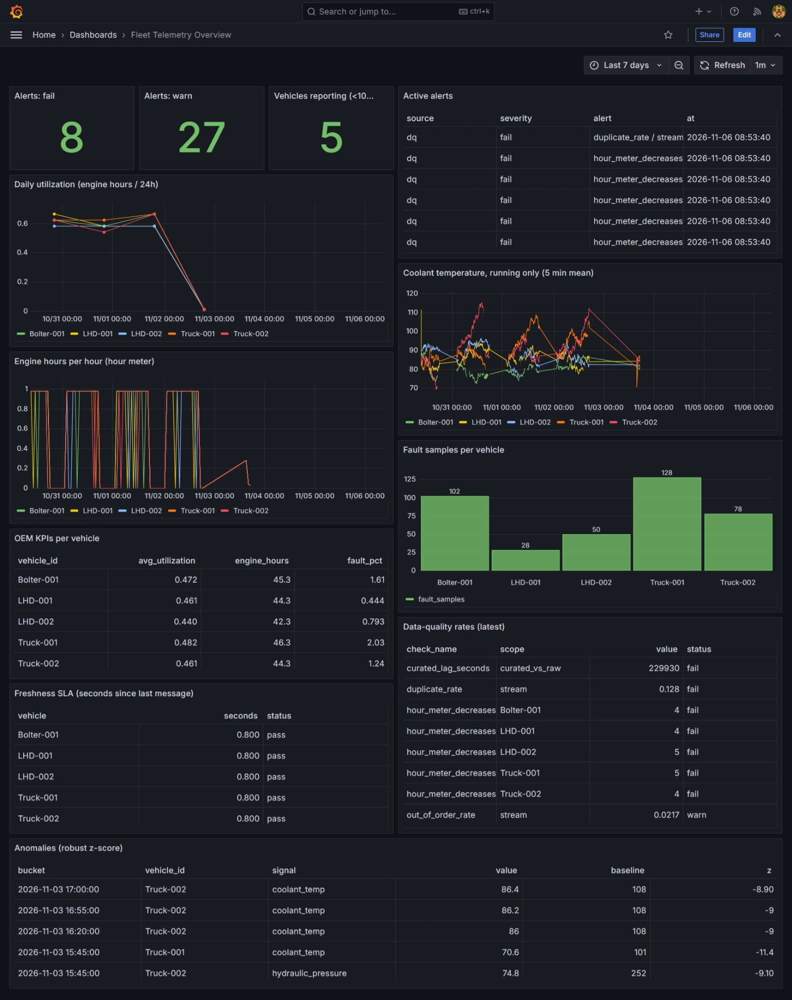
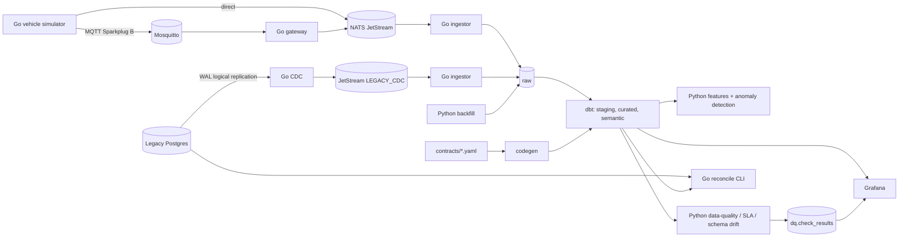

# fleet-telemetry


End-to-end telemetry data platform for a simulated underground-mining fleet.
Go ingestion/CDC/gateway services, a contract-driven warehouse model (dbt), data-quality and SLA monitoring,
Grafana dashboards-as-code and anomaly detection. Go + SQL + Python.



## Architecture



## What it demonstrates

| Area | Implementation |
|---|---|
| Streaming ingestion | Go simulator, NATS JetStream, durable pull consumer, batched idempotent writes |
| Industrial protocol | MQTT + Sparkplug B gateway (hand-rolled protobuf codec, persistent QoS-1 sessions) |
| Modeling | dbt raw → staging → curated → semantic; utilization, hour-meter, fault and OEM KPI facts |
| Data contract | One YAML generates dbt macros, range tests and the data dictionary; CI fails if stale; contract-diff flags breaking changes |
| Data quality / SLA | Null, out-of-range, duplicate, out-of-order rates; hour-meter monotonicity; freshness and latency SLAs; JSON schema-drift detection |
| Migration | Log-based CDC (Postgres pgoutput) to JetStream, state rebuilt in dbt, Go reconciliation CLI with partition hashing and row drill-down |
| Consumption | Grafana provisioned as code, unified alert view, rolling-window features, median/MAD anomaly detection |
| Engineering | Pluggable `Sink` (Postgres, Snowflake MERGE SQL), GitHub Actions CI, Makefile |

## Quick start

```bash
docker compose up -d
source python/.venv/bin/activate && pip install -e "python[dev]"
go run ./cmd/ingestor &
go run ./cmd/simulator -nats nats://localhost:4222 -interval 1s
python -m fleet_tools.backfill --days 7
make dbt && make quality && make features
# Grafana: http://localhost:3000 (admin/admin)
```

MQTT path: `go run ./cmd/gateway` and `go run ./cmd/simulator -mqtt tcp://localhost:1883`.
Migration path: see `legacy/` and `cmd/cdc`, `cmd/reconcile`.

## Design decisions

- **Contract as single source of truth**: dbt macros, tests and docs are generated from `contracts/vehicle_semantics.yaml`.
- **RAW is append-only and idempotent**: keyed on JetStream `stream_seq`. Transport duplicates are dropped; business duplicates are kept for curated to handle.
- **Ack after write**: at-least-once delivery; replays are safe.
- **Log-based CDC, not polling**: captures UPDATE and DELETE; the replication position is confirmed only after JetStream accepts the transaction.
- **Layered reconciliation**: partition hash first, row drill-down only for differing partitions, with a lag cutoff and convergence retries to avoid false alarms.
- **Monitoring that cannot silently pass**: no data is a warning; a broken check is a failure.
- **Curated keeps data and flags it**: out-of-range values become NULL with a reason in `dq_flags`.

## Known limitations

- Sparkplug B: DDATA only (no BIRTH/DEATH state management).
- Rolling-median anomaly baseline absorbs long anomalies and yields false positives during recovery.
- Simulator restarts reset the hour meter (caught by `hour_meter_decreases`).
- Mosquitto queues at most 1000 messages for an offline gateway by default.
- CDC is hand-written for learning; production would use Debezium.
- Local Postgres stands in for the cloud warehouse; the Snowflake sink is unit-tested SQL generation only, not run against a real account.
- OPC UA is not implemented.

## Layout

`cmd/` Go services · `internal/` Go packages · `python/fleet_tools/` Python tooling · `warehouse/dbt/` models · `contracts/` data contract · `grafana/` dashboards-as-code · `legacy/` simulated legacy DB
